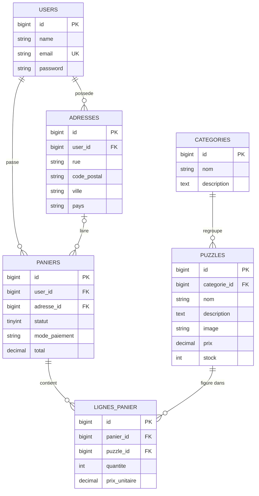

# Modélisation de la base de données — SP1 WoodyCraft

Application web de vente en ligne de puzzles en bois (Laravel / MySQL).

## 1. Règles de gestion

1. Un puzzle appartient à une seule catégorie ; une catégorie regroupe plusieurs puzzles.
2. Un client (utilisateur inscrit) peut enregistrer plusieurs adresses ; une adresse appartient à un seul client.
3. Un client peut avoir plusieurs paniers dans le temps, mais un seul panier « en cours » à la fois.
4. Un panier contient un ou plusieurs puzzles, chacun avec une quantité.
5. Le prix unitaire est recopié dans la ligne du panier au moment de l'ajout, pour que la commande ne change pas si le prix du puzzle évolue ensuite.
6. Quand le client valide son panier, il choisit une adresse de livraison et un mode de paiement (chèque ou PayPal) : le panier devient une commande.
7. Le stock du puzzle est décrémenté à la validation du panier.

## 2. MCD (entités et associations)

| Association | Entité A | Cardinalité A | Entité B | Cardinalité B | Données portées |
|---|---|---|---|---|---|
| APPARTENIR | PUZZLE | 1,1 | CATEGORIE | 0,n | — |
| POSSEDER | ADRESSE | 1,1 | CLIENT | 0,n | — |
| PASSER | PANIER | 1,1 | CLIENT | 0,n | — |
| CONTENIR | PANIER | 0,n | PUZZLE | 0,n | quantite, prix_unitaire |
| LIVRER | PANIER | 0,1 | ADRESSE | 0,n | — |

## 3. MLD (modèle relationnel)

Clés primaires en **gras**, clés étrangères précédées de `#`.

- **users** (**id**, name, email, password, created_at, updated_at)
- **adresses** (**id**, #user_id, rue, code_postal, ville, pays, created_at, updated_at)
- **categories** (**id**, nom, description, created_at, updated_at)
- **puzzles** (**id**, #categorie_id, nom, description, image, prix, stock, created_at, updated_at)
- **paniers** (**id**, #user_id, #adresse_id, statut, mode_paiement, total, created_at, updated_at)
- **lignes_panier** (**id**, #panier_id, #puzzle_id, quantite, prix_unitaire)

Contraintes :

- `users.email` est unique.
- `(panier_id, puzzle_id)` est unique dans `lignes_panier` : un puzzle n'apparaît qu'une fois par panier, on augmente la quantité.
- `paniers.adresse_id` et `paniers.mode_paiement` sont NULL tant que le panier n'est pas validé.

## 4. Dictionnaire de données

| Table | Champ | Type | Commentaire |
|---|---|---|---|
| users | name | VARCHAR(255) | Nom du client |
| users | email | VARCHAR(255) | Identifiant de connexion, unique |
| users | password | VARCHAR(255) | Mot de passe haché |
| adresses | rue | VARCHAR(255) | Numéro et nom de rue |
| adresses | code_postal | VARCHAR(10) | |
| adresses | ville | VARCHAR(100) | |
| adresses | pays | VARCHAR(100) | « France » par défaut |
| categories | nom | VARCHAR(100) | |
| categories | description | TEXT | Facultatif |
| puzzles | nom | VARCHAR(150) | |
| puzzles | description | TEXT | |
| puzzles | image | VARCHAR(255) | Chemin du fichier image |
| puzzles | prix | DECIMAL(8,2) | Prix TTC en euros |
| puzzles | stock | INT | Quantité disponible, ≥ 0 |
| paniers | statut | TINYINT | 0 = en cours, 1 = validé, 2 = payé, 3 = expédié |
| paniers | mode_paiement | VARCHAR(20) | `cheque` ou `paypal`, NULL si non validé |
| paniers | total | DECIMAL(8,2) | Montant calculé à la validation |
| lignes_panier | quantite | INT | ≥ 1 |
| lignes_panier | prix_unitaire | DECIMAL(8,2) | Prix du puzzle au moment de l'ajout |

La table `users` est celle déjà créée par Laravel Breeze ; les autres tables sont à créer par migrations.
