# Préparation de l'oral — présentation carte par carte

Ouvrir ce fichier en aperçu Markdown dans VS Code (`Ctrl+Shift+V`) pour voir les captures.
Le texte est écrit comme on le dirait à l'oral : à relire puis à redire avec ses propres mots.
Pour chaque carte : pourquoi elle arrive à ce moment, le code expliqué, puis les captures qui prouvent que ça marche.

## Introduction

> Après la maquette (carte #1) et la modélisation (carte #2), j'ai attaqué le développement. J'ai suivi un ordre simple : chaque carte s'appuie sur la précédente. D'abord la base de données, ensuite des données pour tester, puis la mise en page commune, et enfin les fonctionnalités dans l'ordre du parcours client : le catalogue, puis le panier. J'ai fini par la sécurité de l'administration. Pour chaque carte, je fais le back avant le front : les pages finales ont besoin des routes et des données.
>
> Pour chaque carte, je vérifie en base avec phpMyAdmin et sur le site, je prends des captures et je les mets en commentaire de la carte sur GitHub. Je fais un commit par carte et je note mes choix dans le journal de bord.

### Rappel : comment une page est produite dans Laravel

À avoir en tête, car toutes les cartes suivent ce chemin :

1. **La route** (`routes/web.php`) associe une URL à une méthode de contrôleur.
2. **Le contrôleur** (`app/Http/Controllers`) récupère les données grâce aux modèles.
3. **Le modèle** (`app/Models`) représente une table ; Eloquent écrit le SQL à notre place.
4. **La vue** (`resources/views`, fichiers Blade) affiche les données en HTML.

Les **migrations** (`database/migrations`) créent ou modifient les tables, et les **seeders** (`database/seeders`) les remplissent.

---

## Carte #3 — Création des tables

**Pourquoi en premier :**
> Tout le reste du site lit ou écrit dans ces tables. Sans `categories`, pas de catalogue ; sans `carts`, pas de panier. C'était donc la première chose à faire.

**Le code :** une migration par table. Exemple avec les lignes du panier, `database/migrations/2026_10_08_160300_create_cart_items_table.php` :

```php
public function up(): void
{
    Schema::create('cart_items', function (Blueprint $table) {
        $table->id();
        $table->foreignId('cart_id')->constrained()->cascadeOnDelete();
        $table->foreignId('computer_id')->constrained()->cascadeOnDelete();
        $table->unsignedInteger('quantity')->default(1);

        // Un ordinateur n'apparaît qu'une fois par panier : on augmente sa quantité.
        $table->unique(['cart_id', 'computer_id']);
    });
}
```

> - `up()` est exécutée par `php artisan migrate`. `down()`, plus bas dans le fichier, fait l'inverse : elle supprime la table.
> - `$table->id()` crée la clé primaire `id`, auto-incrémentée.
> - `foreignId('cart_id')->constrained()` crée la colonne **et** la clé étrangère vers `carts.id`. Laravel déduit le nom de la table à partir du nom de la colonne.
> - `cascadeOnDelete()` : si on supprime le panier, ses lignes sont supprimées avec lui.
> - `unsignedInteger` : une quantité n'est jamais négative.
> - `unique([...])` : un index unique sur le couple panier + ordinateur.

Dans `order_items`, la différence est volontaire :

```php
$table->foreignId('order_id')->constrained()->cascadeOnDelete();
// Pas de cascade : un ordinateur déjà commandé ne peut pas être supprimé.
$table->foreignId('computer_id')->constrained();
// Prix de l'ordinateur au moment de la commande.
$table->decimal('unit_price', 8, 2);
```

> Sans `cascadeOnDelete()`, MySQL refuse de supprimer un ordinateur qui figure dans une commande : on garde l'historique. Et je recopie le prix dans `unit_price` : si le prix de l'ordinateur change plus tard, une commande déjà passée ne doit pas changer.

Chaque table a aussi un modèle avec ses relations, par exemple `app/Models/Category.php` :

```php
public function computers(): HasMany
{
    return $this->hasMany(Computer::class);
}
```

> Une catégorie a plusieurs ordinateurs. Ensuite, `$category->computers` me donne ses ordinateurs sans écrire de requête SQL.

**Les preuves :**

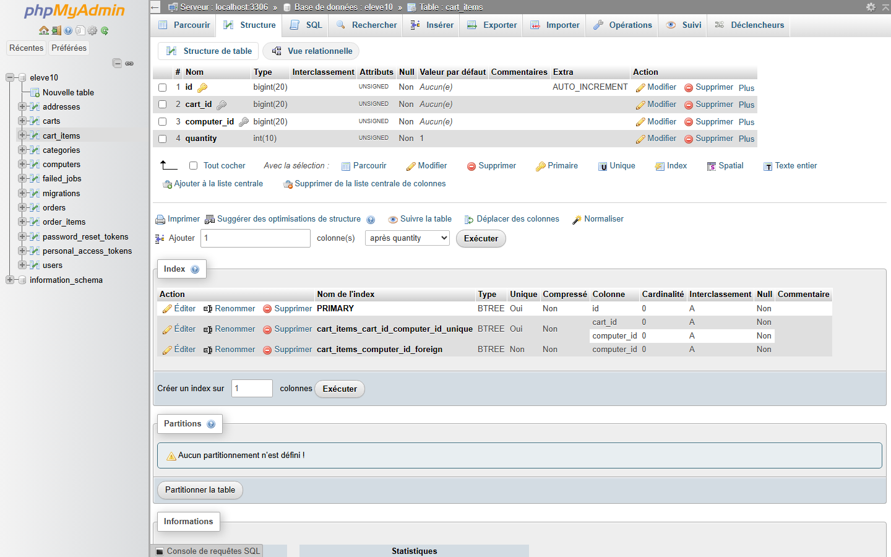

> En bas, l'index unique `cart_items_cart_id_computer_id_unique`.

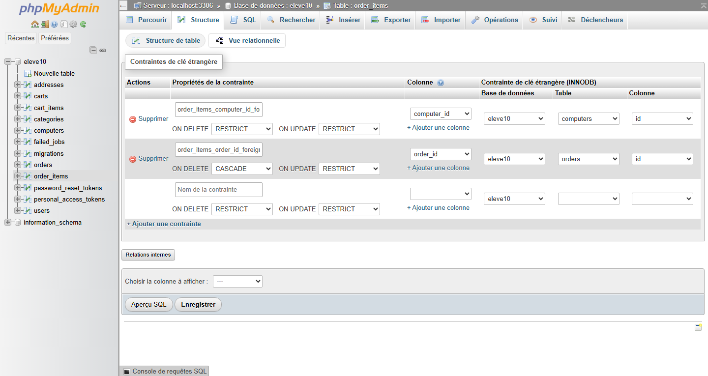

> CASCADE sur `order_id`, RESTRICT sur `computer_id` : c'est exactement ce que dit la migration.

---

## Carte #4 — Adaptation de la table `computers`

**Pourquoi maintenant :**
> La table `computers` existait déjà, mais la catégorie y était écrite en texte libre et le prix était un FLOAT. Il fallait la corriger avant de construire le catalogue dessus.

**Le code :** `database/migrations/2026_10_09_090000_adapt_computers_table.php`. La difficulté : la table contenait déjà des ordinateurs, que je ne voulais pas perdre. La migration se fait donc en 3 étapes.

```php
// 1. Ajouter la nouvelle colonne, vide pour l'instant (nullable)
Schema::table('computers', function (Blueprint $table) {
    $table->unsignedBigInteger('category_id')->nullable()->after('id');
});

// 2. Transformer chaque catégorie en texte en une ligne de categories
$names = DB::table('computers')->distinct()->pluck('category');

foreach ($names as $name) {
    $categoryName = mb_substr(trim($name), 0, 100);

    DB::table('categories')->insertOrIgnore([
        'name' => $categoryName,
        'created_at' => now(),
        'updated_at' => now(),
    ]);

    DB::table('computers')
        ->where('category', $name)
        ->update([
            'category_id' => DB::table('categories')->where('name', $categoryName)->value('id'),
        ]);
}

// 3. Rendre la colonne obligatoire, ajouter la clé étrangère, supprimer l'ancienne colonne
Schema::table('computers', function (Blueprint $table) {
    $table->unsignedBigInteger('category_id')->nullable(false)->change();
    $table->foreign('category_id')->references('id')->on('categories');
    $table->dropColumn('category');
    $table->decimal('price', 8, 2)->change();
});
```

> - Étape 1 : la colonne est d'abord `nullable`, sinon MySQL refuserait de l'ajouter alors que des lignes existent déjà.
> - Étape 2 : `distinct()->pluck('category')` récupère la liste des catégories différentes. Pour chacune, je crée la catégorie (`insertOrIgnore` ne fait rien si elle existe déjà), puis je remplis `category_id` des ordinateurs concernés.
> - `mb_substr(..., 0, 100)` coupe le nom à 100 caractères, la taille de la colonne `name` de `categories`. Le préfixe `mb_` gère les accents.
> - Étape 3 : une fois toutes les lignes remplies, je peux rendre la colonne obligatoire, ajouter la clé étrangère et passer le prix en DECIMAL(8,2) : 8 chiffres dont 2 après la virgule, soit 999 999,99 au maximum.

> Pourquoi DECIMAL et pas FLOAT ? Un FLOAT est une valeur approchée : 0,1 + 0,2 n'y vaut pas exactement 0,3. Pour de l'argent, il faut une valeur exacte.

**Les preuves :**

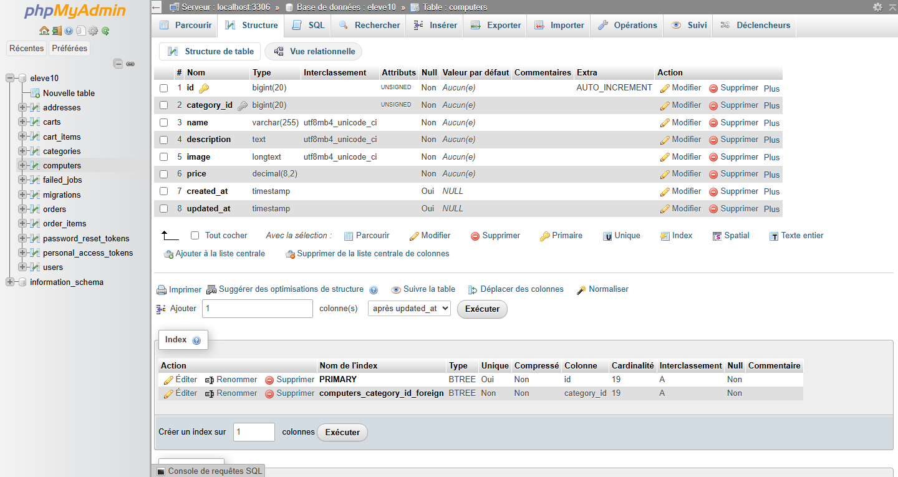

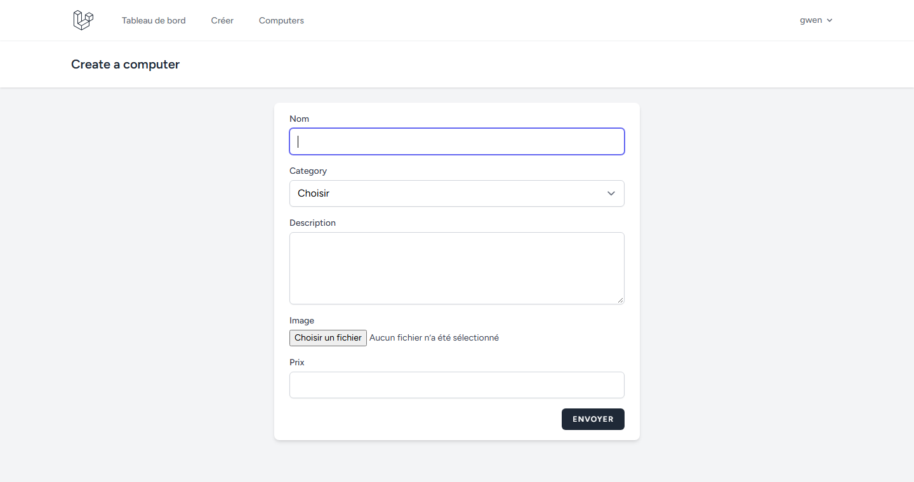

> Dans le formulaire, la catégorie se choisit maintenant dans une liste déroulante, remplie à partir de la table `categories`.

---

## Carte #6 — Données de démonstration

**Pourquoi maintenant :**
> Pour vérifier une page, il faut quelque chose à afficher. Avec des données dès le départ, j'ai pu tester toutes les cartes suivantes avec de vraies données.

**Le code :** `database/seeders/ComputerSeeder.php`. Les ordinateurs sont rangés par catégorie dans une constante :

```php
private const COMPUTERS = [
    'Portables' => [
        ['Portable Érable 14', 749.00, "Écran 14\" Full HD IPS, Intel Core i5-1335U, ..."],
        // ...
    ],
    // ...
];

public function run(): void
{
    foreach (self::COMPUTERS as $categoryName => $computers) {
        $category = Category::firstOrCreate(['name' => $categoryName]);

        foreach ($computers as [$name, $price, $description]) {
            Computer::updateOrCreate(
                ['name' => $name],
                [
                    'category_id' => $category->id,
                    'description' => $description,
                    'image'       => $this->placeholder($name, $categoryName),
                    'price'       => $price,
                ]
            );
        }
    }
}
```

> - `run()` est exécutée par `php artisan db:seed`.
> - `firstOrCreate` : cherche la catégorie par son nom, et la crée seulement si elle n'existe pas.
> - `updateOrCreate` : cherche l'ordinateur par son nom (premier tableau) ; s'il existe, il est mis à jour avec le second tableau, sinon il est créé.
> - Grâce à ces deux méthodes, je peux relancer le seeder autant de fois que je veux : il ne crée jamais de doublons.
> - `foreach ($computers as [$name, $price, $description])` découpe directement chaque petit tableau en trois variables.
> - `placeholder()` génère une image SVG avec le nom de l'ordinateur, aux couleurs de la maquette : pas de fichiers image à télécharger ni de droits à gérer.

**Les preuves :**

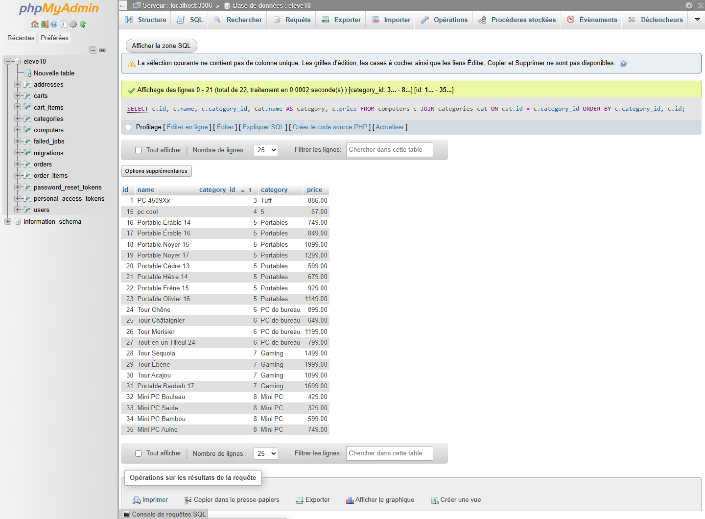

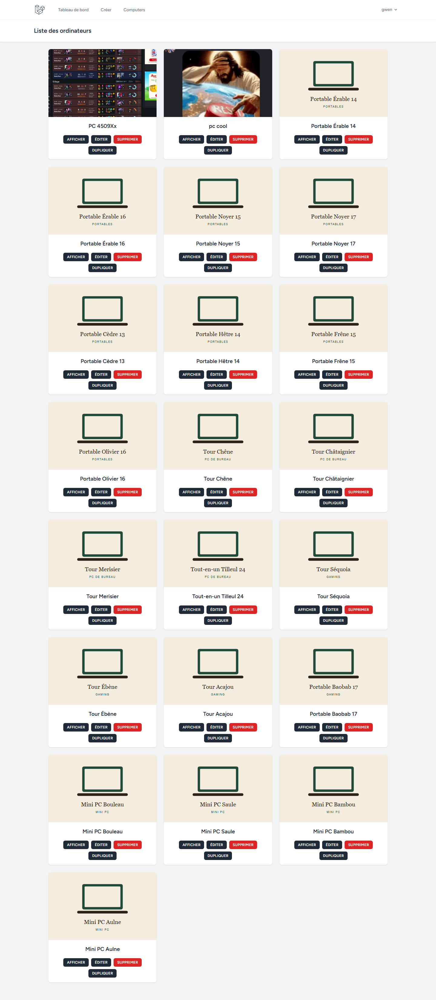

---

## Carte #7 — Mise en page commune

**Pourquoi maintenant :**
> L'en-tête, le pied de page, les couleurs et les polices sont partagés par toutes les pages. En les faisant une seule fois au début, je n'ai pas eu à reprendre chaque page ensuite.

**Le code :** toutes les pages utilisent le même layout Blade (`layouts/app`), qui inclut l'en-tête (`layouts/navigation`) et le pied de page (`layouts/footer`). Les couleurs de la maquette sont ajoutées à Tailwind (`cream`, `pine`, `bark`).

La partie intéressante est le nombre d'articles du panier, dans `app/Providers/AppServiceProvider.php` :

```php
public function boot(): void
{
    // Nombre d'articles du panier, affiché dans l'en-tête de chaque page
    View::composer('layouts.navigation', function ($view) {
        $cart = Cart::current();

        $view->with('cartCount', $cart ? (int) $cart->items()->sum('quantity') : 0);
    });
}
```

> - L'en-tête apparaît sur toutes les pages. Je ne voulais pas calculer le nombre d'articles dans chaque contrôleur : un **composeur de vue** (`View::composer`) s'exécute à chaque fois que la vue `layouts.navigation` est affichée.
> - `Cart::current()` retrouve le panier du visiteur (je l'explique à la carte #11).
> - `sum('quantity')` fait l'addition directement en SQL. J'additionne les quantités : 2 fois le même ordinateur compte pour 2 articles.
> - S'il n'a pas de panier, j'envoie 0.

**Les preuves :**

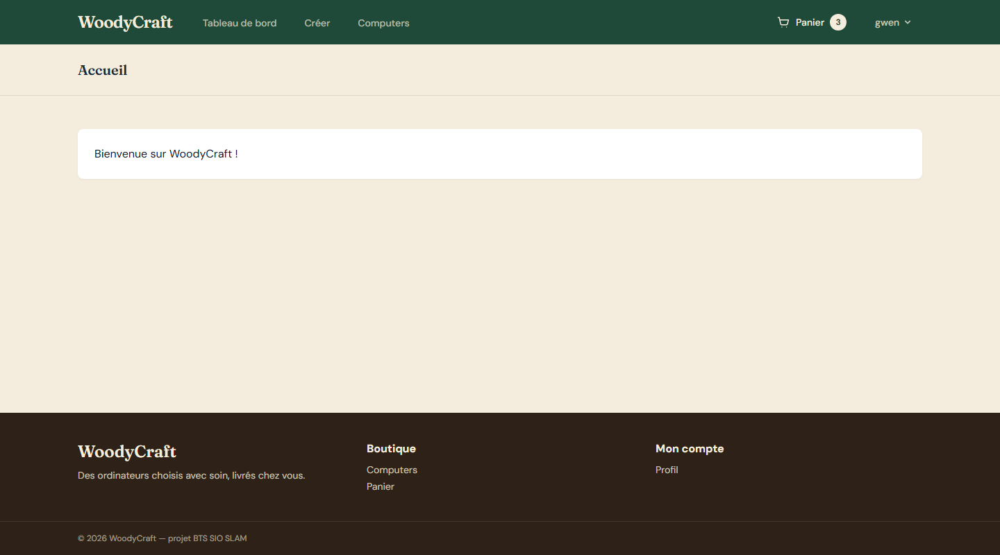

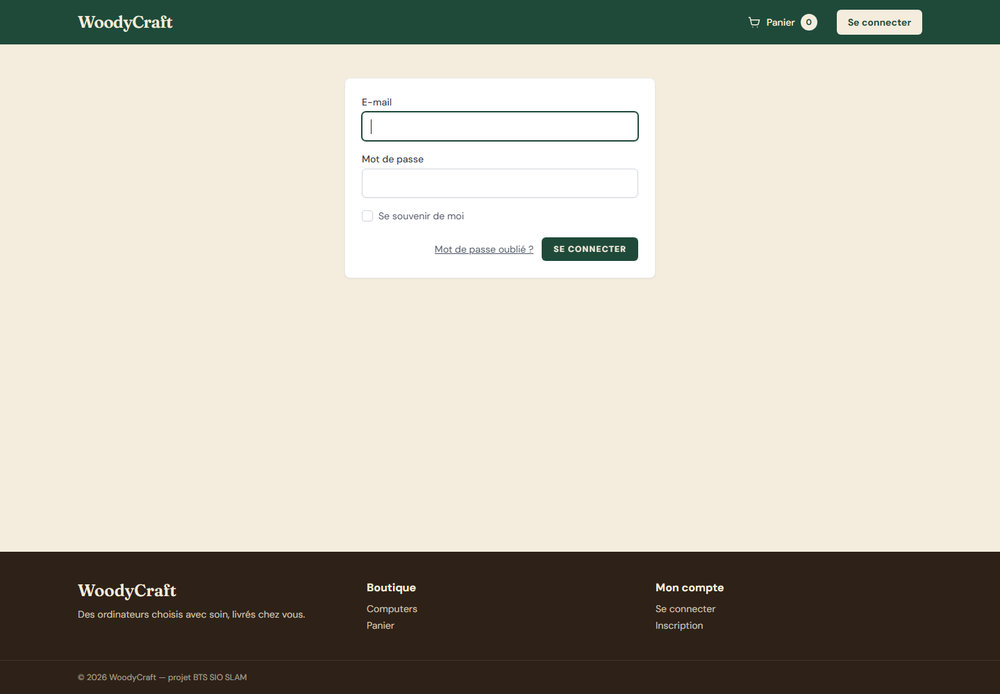

---

## Carte #8 — US01 : les catégories sur l'accueil

**Pourquoi maintenant :**
> C'est le début du parcours client : on arrive sur le site et on voit les catégories.

**Le code :**

```php
// routes/web.php
Route::get('/', [HomeController::class, 'index'])->name('home');
```

```php
// app/Http/Controllers/HomeController.php
public function index()
{
    $categories = Category::orderBy('name')->get();
    return view('home', compact('categories'));
}
```

> - La route : quand on demande `/` en GET, Laravel appelle la méthode `index` de `HomeController`. Le nom `home` permet d'écrire `route('home')` dans les vues plutôt que l'URL en dur.
> - La route n'a pas de middleware `auth` : la page est publique.
> - `Category::orderBy('name')->get()` correspond à `SELECT * FROM categories ORDER BY name`.
> - `compact('categories')` crée le tableau `['categories' => $categories]` : la vue reçoit une variable `$categories`, qu'elle parcourt avec `@foreach`.

**Les preuves :**

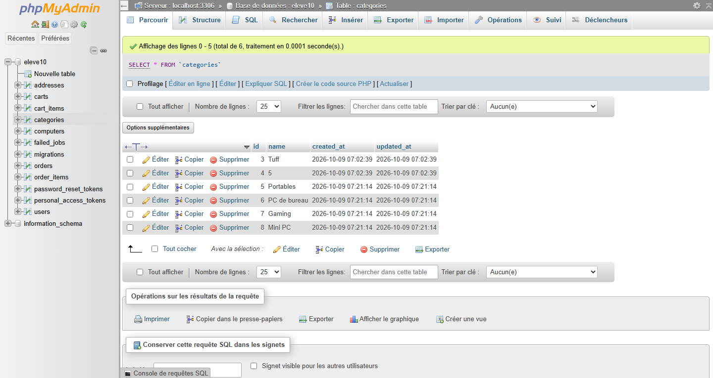

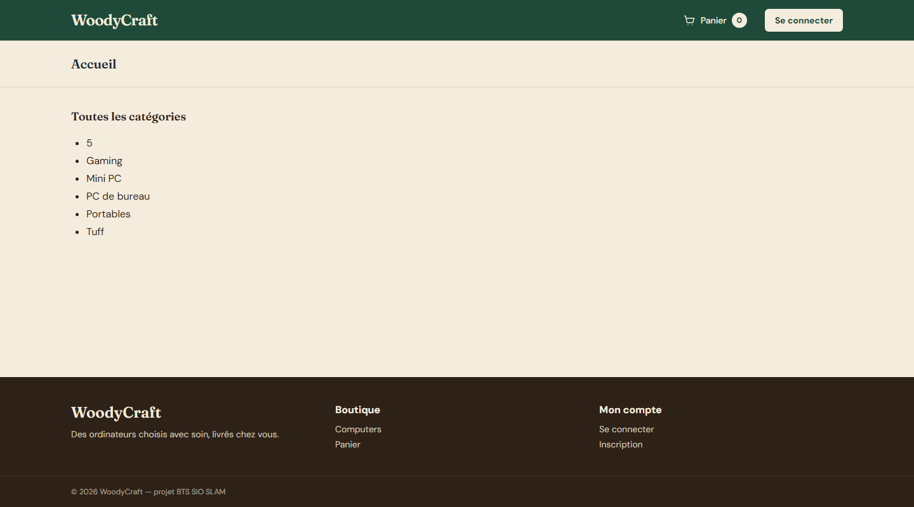

> Les mêmes catégories en base et sur la page. La mise en forme de la maquette relève de la carte front #25.

---

## Carte #9 — US02 : les ordinateurs d'une catégorie

**Le code :**

```php
// routes/web.php
Route::get('/categories/{category}', [CategoryController::class, 'show'])->name('categories.show');
```

```php
// app/Http/Controllers/CategoryController.php
public function show(Category $category)
{
    $computers = $category->computers()->orderBy('name')->get();
    return view('categories.show', compact('category', 'computers'));
}
```

> - `{category}` est un paramètre de l'URL : pour `/categories/5`, il vaut 5.
> - Le paramètre de la méthode est typé `Category $category` : c'est la **liaison de modèle** (route model binding). Laravel cherche lui-même la catégorie d'id 5 et me donne l'objet. Si elle n'existe pas, il renvoie directement une 404 : je n'ai pas à écrire ce test.
> - `$category->computers()` utilise la relation de la carte #3 : `SELECT * FROM computers WHERE category_id = 5 ORDER BY name`. Je ne récupère que les ordinateurs de cette catégorie.

**Les preuves :**

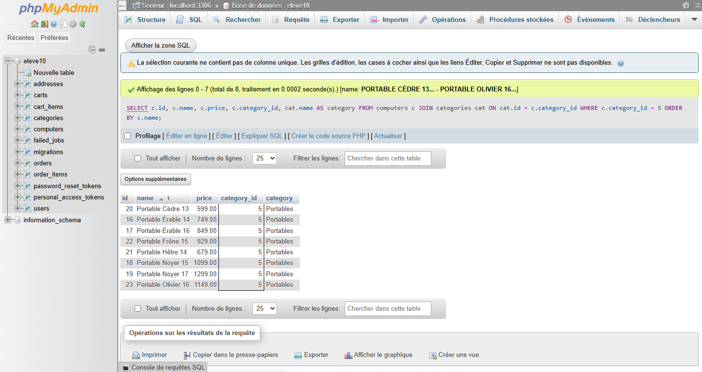

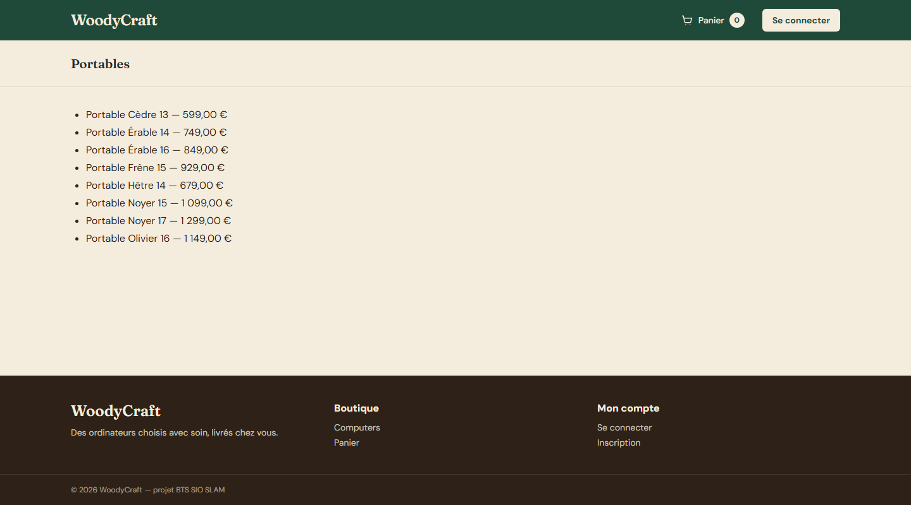

> 8 portables en base, 8 portables sur la page.

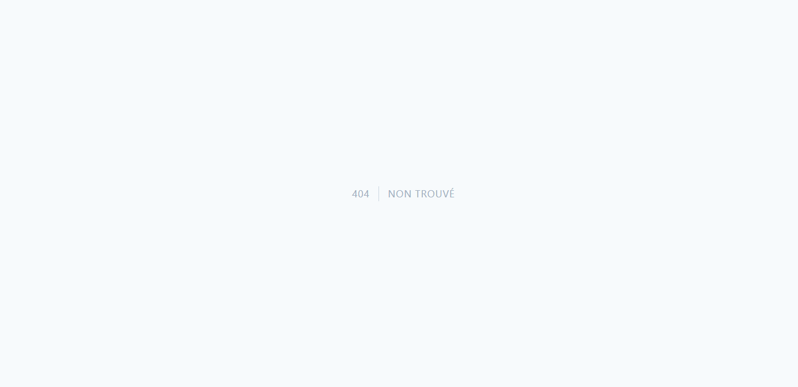

> `/categories/999` : la liaison de modèle renvoie la 404.

---

## Carte #10 — US03 : la page d'un ordinateur

**Le code :**

```php
// routes/web.php
Route::resource('computers', computerController::class)->except('show');   // dans le groupe protégé

// Page d'un ordinateur : accessible sans connexion (déclarée après /computers/create)
Route::get('/computers/{computer}', [computerController::class, 'show'])->name('computers.show');
```

```php
// app/Http/Controllers/computerController.php
public function show(Computer $computer)
{
    // Page publique : l'ordinateur et sa catégorie
    $computer->load('category');
    return view('computers.show', compact('computer'));
}
```

> - `Route::resource` crée d'un coup les 7 routes classiques (index, create, store, show, edit, update, destroy). `->except('show')` retire `show` du groupe qui demande une connexion, et je la redéclare à part, sans middleware : elle devient publique.
> - **L'ordre compte** : Laravel prend la première route qui correspond. Si `/computers/{computer}` était déclarée en premier, `/computers/create` serait pris pour l'ordinateur « create » et renverrait une 404. Je la déclare donc en dernier.
> - `load('category')` charge la catégorie de l'ordinateur pour que la vue puisse afficher `$computer->category->name`.

**La preuve :**

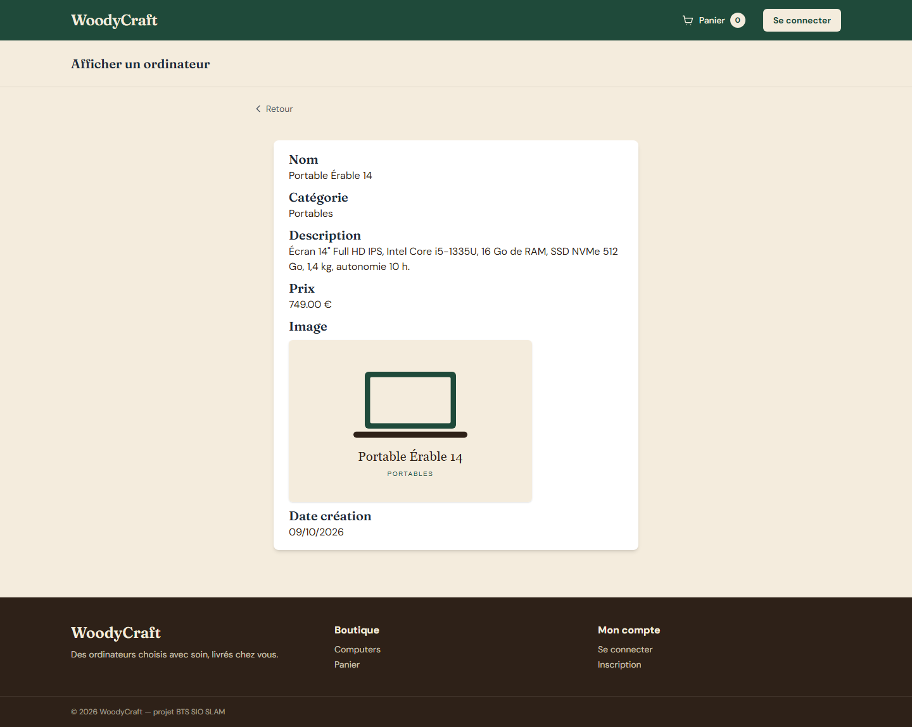

> Le bouton « Se connecter » en haut montre que je ne suis pas connecté, et j'ai quand même accès à la page.

---

## Carte #11 — US04 : ajouter au panier

**Pourquoi maintenant :**
> Le catalogue est en place, on peut donc ajouter au panier.

**Le code :** d'abord, retrouver le panier du visiteur, dans `app/Models/Cart.php` :

```php
public static function current(): ?self
{
    return Auth::check()
        ? self::where('user_id', Auth::id())->first()
        : self::where('session_id', session()->getId())->first();
}

public static function currentOrCreate(): self
{
    return Auth::check()
        ? self::firstOrCreate(['user_id' => Auth::id()])
        : self::firstOrCreate(['session_id' => session()->getId()]);
}
```

> - `Auth::check()` vaut vrai si l'utilisateur est connecté.
> - Connecté : je cherche son panier par `user_id`. Visiteur : par l'identifiant de sa session, que Laravel garde dans un cookie.
> - `? :` est l'opérateur ternaire : un `if / else` sur une ligne.
> - `current()` peut renvoyer `null` (pas encore de panier : `?self`). `currentOrCreate()` crée le panier s'il n'existe pas.
> - Les méthodes sont `static` : on les appelle sur la classe (`Cart::current()`), sans objet.
> - Je les ai mises dans le modèle et pas dans le contrôleur, car elles servent à plusieurs endroits : le contrôleur du panier et le compteur de l'en-tête.

Ensuite, l'ajout dans `app/Http/Controllers/CartController.php` :

```php
public function add(Computer $computer)
{
    $cart = Cart::currentOrCreate();

    $item = $cart->items()->firstOrNew(['computer_id' => $computer->id]);
    $item->quantity = $item->exists ? $item->quantity + 1 : 1;
    $item->save();

    return back()->with('message', 'Ordinateur ajouté au panier.');
}
```

> - `firstOrNew` cherche la ligne de cet ordinateur dans le panier. Si elle n'existe pas, il prépare une nouvelle ligne, mais sans l'enregistrer encore.
> - `$item->exists` indique si la ligne vient de la base. Si oui, la quantité augmente de 1 ; sinon elle vaut 1.
> - `save()` fait un UPDATE ou un INSERT selon le cas.
> - `back()` renvoie sur la page précédente, avec un message temporaire (flash) en session.
> - La route est en POST : Laravel exige le jeton CSRF, ce qui empêche un autre site de remplir le panier à la place du visiteur.

**Les preuves :**

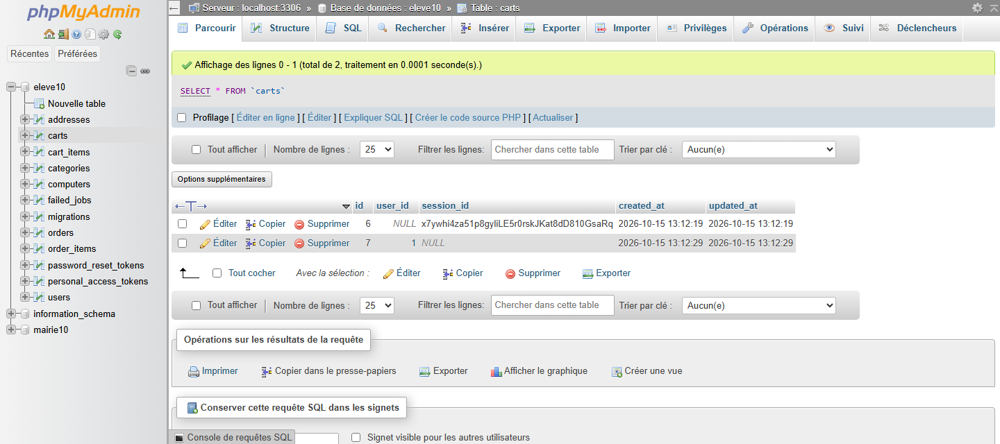

> Le panier 6 appartient à un visiteur (`session_id`), le panier 7 à un client connecté (`user_id`).

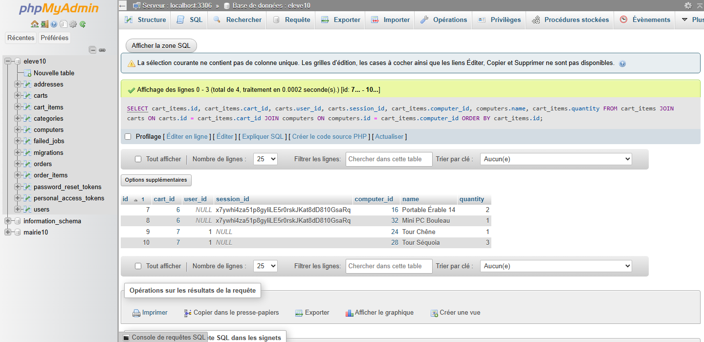

> Le même ordinateur ajouté deux fois donne une seule ligne, en quantité 2.

---

## Carte #12 — US05 : modifier la quantité

**Le code :**

```php
// app/Http/Controllers/CartController.php
public function update(Request $request, CartItem $item)
{
    $this->checkOwner($item);

    $validated = $request->validate([
        'quantity' => 'required|integer|min:1',
    ]);

    $item->update($validated);

    return redirect()->route('cart.index')
        ->with('message', 'Quantité mise à jour.');
}
```

> - `checkOwner` vérifie que la ligne est bien dans le panier du visiteur (je l'explique à la carte #13).
> - `validate` : la quantité est obligatoire, entière et au moins égale à 1. Si ce n'est pas le cas, Laravel arrête la méthode et renvoie sur la page avec le message d'erreur. Rien n'est enregistré.
> - Je n'enregistre que `$validated`, c'est-à-dire les champs validés, et jamais toute la requête.

Les totaux sont calculés dans les modèles :

```php
// app/Models/CartItem.php
public function total(): float
{
    return round($this->computer->price * $this->quantity, 2);
}

// app/Models/Cart.php
public function total(): float
{
    return round($this->items->sum(fn (CartItem $item) => $item->total()), 2);
}
```

> - Total d'une ligne : prix × quantité, arrondi à 2 décimales.
> - Total du panier : la somme des totaux des lignes. `fn (...) => ...` est une fonction fléchée, que `sum` appelle pour chaque ligne.
> - Je les ai mis dans les modèles pour pouvoir les réutiliser dans le panier, et plus tard dans la commande.

**Les preuves :**

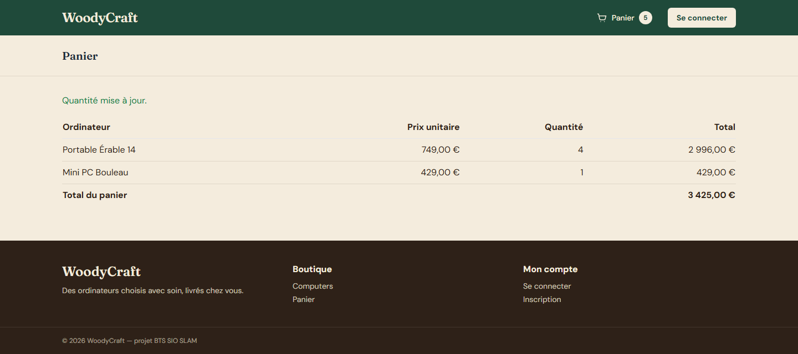

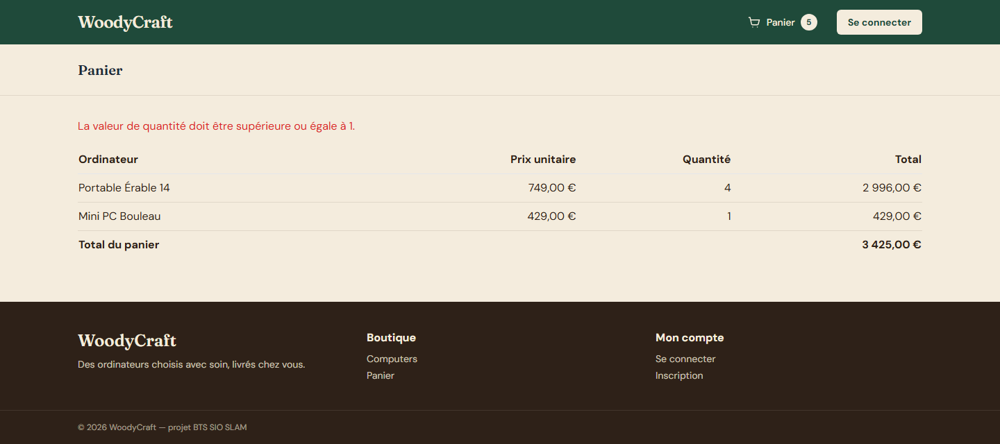

> 0, « abc », 2,5 et un champ vide sont refusés avec un message en français.

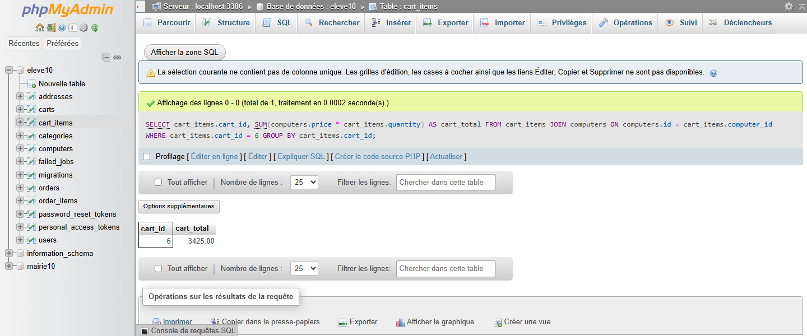

> J'ai refait le calcul en SQL dans phpMyAdmin pour vérifier mes méthodes : on trouve les mêmes montants.

---

## Carte #13 — US06 : supprimer une ligne du panier

**Le code :**

```php
// app/Http/Controllers/CartController.php
public function destroy(CartItem $item)
{
    $this->checkOwner($item);

    $item->delete();

    return redirect()->route('cart.index')
        ->with('message', 'Ordinateur retiré du panier.');
}

private function checkOwner(CartItem $item): void
{
    abort_if($item->cart_id !== Cart::current()?->id, 403);
}
```

> - L'URL contient le numéro de la ligne : `/cart/items/10`. Sans vérification, il suffirait de changer ce numéro pour supprimer une ligne du panier de quelqu'un d'autre.
> - `checkOwner` compare le panier de la ligne avec le panier du visiteur. S'ils sont différents, `abort_if` arrête tout avec une erreur 403 (accès interdit).
> - `?->` : si le visiteur n'a pas de panier, `current()` renvoie `null` et l'expression vaut `null` au lieu de planter. La comparaison est fausse, donc 403.
> - La méthode est `private` : elle sert à `update` et à `destroy`, sans être une page.

**Les preuves :**

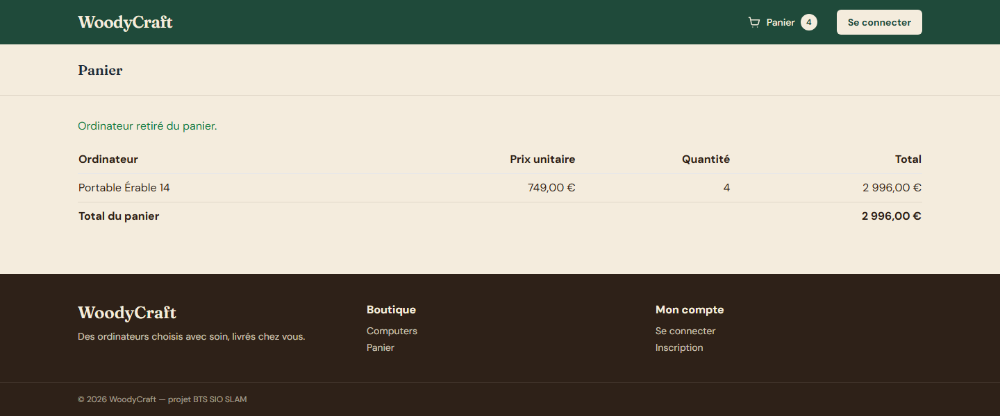


> J'essaie de supprimer la ligne d'un autre panier : je reçois une 403…

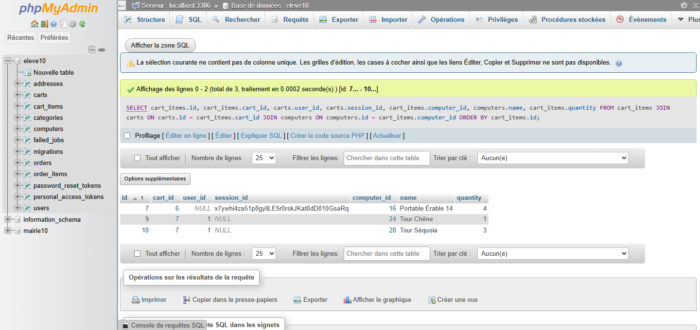

> …et la ligne est toujours en base.

---

## Carte #5 — Rôle administrateur

**Pourquoi à ce moment :**
> En relisant mes routes, j'ai vu que n'importe quel utilisateur connecté pouvait créer, modifier ou supprimer des ordinateurs. C'est une faille de sécurité, je l'ai corrigée avant d'aller plus loin dans l'administration et avant de faire les pages front.

**Le code, en 4 parties.**

1. La colonne, `database/migrations/2026_10_15_140000_add_is_admin_to_users_table.php` :

```php
Schema::table('users', function (Blueprint $table) {
    // Les comptes existants restent de simples clients
    $table->boolean('is_admin')->default(false)->after('password');
});
```

> `Schema::table` (et pas `create`) modifie une table existante. `default(false)` : les comptes déjà inscrits deviennent des clients, sans perte de données. Dans MySQL, un booléen est un `tinyint(1)`.

2. Le middleware, `app/Http/Middleware/EnsureUserIsAdmin.php` :

```php
public function handle(Request $request, Closure $next): Response
{
    abort_unless($request->user()?->is_admin, 403);

    return $next($request);
}
```

> - Un **middleware** est un filtre exécuté avant le contrôleur.
> - `abort_unless(condition, 403)` : si la condition est fausse, la requête s'arrête avec une 403.
> - `$next($request)` laisse passer la requête vers le contrôleur.
> - Je l'ai enregistré sous le nom `admin` dans `app/Http/Kernel.php` : `'admin' => \App\Http\Middleware\EnsureUserIsAdmin::class`.

3. Les routes, `routes/web.php` :

```php
// Gestion des ordinateurs : réservée à l'administrateur
Route::middleware(['auth', 'admin'])->group(function () {
    Route::post('/computers/{computer}/duplicate', [computerController::class, 'duplicate'])
        ->name('computers.duplicate');

    Route::resource('computers', computerController::class)->except('show');
});
```

> - Les deux middlewares s'appliquent dans l'ordre : `auth` renvoie le visiteur vers la connexion, puis `admin` renvoie une 403 au client.
> - Comme c'est un groupe, une nouvelle route de gestion ajoutée dedans sera protégée d'office.

4. Le compte de démonstration, `database/seeders/AdminSeeder.php` :

```php
// is_admin n'est pas dans $fillable : il est affecté à la main
$admin = User::firstOrNew(['email' => 'admin@woodycraft.test']);
$admin->name = 'Administrateur';
$admin->is_admin = true;

if (! $admin->exists) {
    $admin->password = Hash::make('password');
}

$admin->save();
```

> - `$fillable` est la liste des champs qu'on peut remplir en une fois à partir d'un formulaire. Je n'y ai **pas** mis `is_admin` : sinon quelqu'un pourrait ajouter `is_admin=1` au formulaire d'inscription et devenir administrateur. Je l'affecte donc champ par champ.
> - `Hash::make` chiffre le mot de passe (bcrypt) : il n'est jamais stocké en clair.
> - Je ne fixe le mot de passe qu'à la création : si on relance le seeder, un mot de passe déjà changé n'est pas écrasé.
> - Dans le modèle `User`, j'ai ajouté le cast `'is_admin' => 'boolean'` : Laravel renvoie `true` / `false` au lieu de 1 / 0.

**Les preuves :**

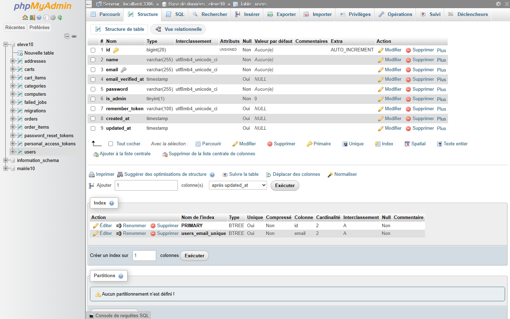

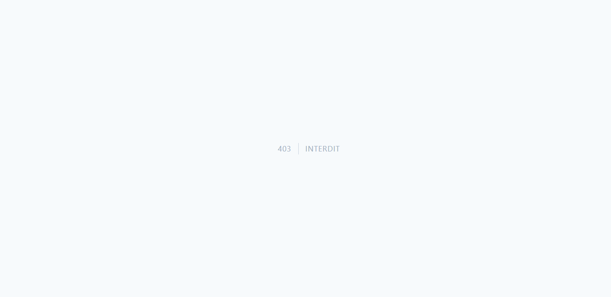

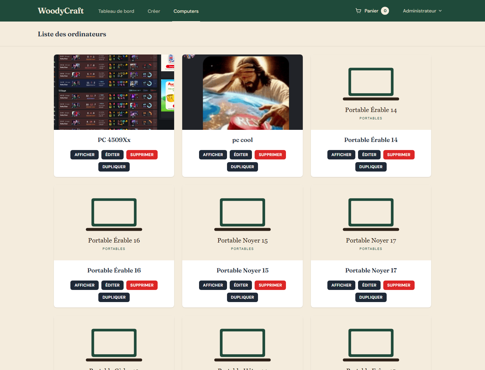

> Un client connecté reçoit une 403, l'administrateur accède à la gestion. Un visiteur est renvoyé vers la connexion.

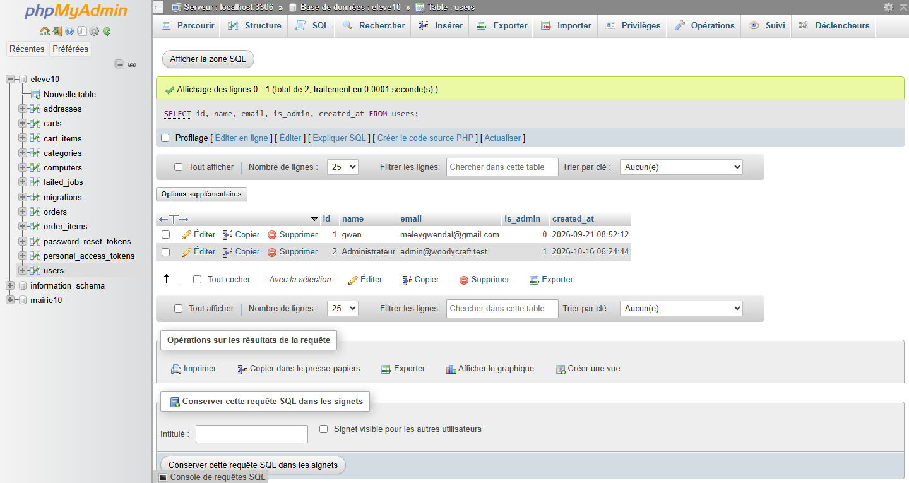

**Questions possibles :**
- *Pourquoi une 403 et pas une redirection vers la connexion ?*
  > Le client est déjà connecté : on sait qui il est, mais il n'a pas le droit.
- *Pourquoi un booléen et pas une table des rôles ?*
  > Le sujet ne prévoit que deux profils, client et administrateur.

---

## Conclusion

> Le back du catalogue et du panier est terminé, et l'administration est protégée. La suite : les cartes front pour mettre les pages aux couleurs de la maquette, rattacher le panier au compte à la connexion, puis la commande.
>
> Ce qui n'est pas encore fait : il n'y a pas de tests automatiques, car le fichier de configuration des tests pointe sur la base de travail et ils la videraient. Il faudrait d'abord configurer une base de test séparée.

## Petit lexique pour répondre aux questions

| Terme | En une phrase |
|---|---|
| Migration | Fichier PHP qui crée ou modifie une table ; on peut l'annuler avec `down()` |
| Seeder | Fichier PHP qui remplit la base avec des données |
| Modèle / Eloquent | Classe qui représente une table ; Eloquent écrit le SQL à notre place |
| Relation (`hasMany`, `belongsTo`) | Lien entre deux modèles, qui suit une clé étrangère |
| Liaison de modèle | Laravel transforme l'id de l'URL en objet, ou renvoie une 404 |
| Middleware | Filtre exécuté avant le contrôleur (`auth`, `admin`) |
| `$fillable` | Liste des champs qu'on peut remplir en une fois depuis un formulaire |
| CSRF | Jeton caché dans les formulaires, qui empêche un autre site d'envoyer une requête à notre place |
| `validate()` | Vérifie les données envoyées et renvoie les erreurs au formulaire |
| 403 / 404 / 419 | Interdit / introuvable / jeton CSRF manquant ou expiré |
